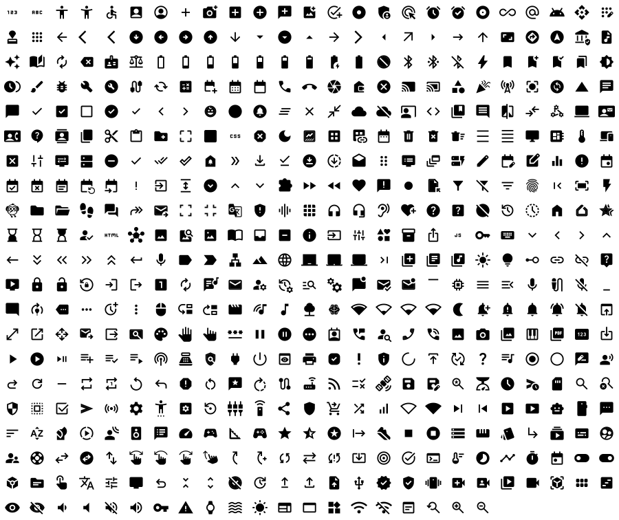

# icons

icons is the part of OmniPython that gives a program Google's Material Symbols
at any size, as antialiased 8-bit alpha masks, drawn by `ttfio` from a font
that stays in flash on MicroPython-compatible firmware and runs the same on
CPython.

On a board, use a firmware built with the `ttfio` and `icons` modules. On a
desktop, `pip install omnipython-desktop` carries it, with `ttfio` over
freetype-py.

```python
import icons

print(len(icons.names()), "icons; wifi is", "in" if icons.has("wifi") else "out")

# A mask is size * size alpha bytes, row by row. Print every other row as text.
data, w, h = icons.mask("wifi", 20)
for y in range(0, h, 2):
    print("".join(" .:#"[a * 4 // 256] for a in data[y * w:(y + 1) * w]))
```

```text
520 icons; wifi is in
                    
                    
   .############.   
.###.          .###.
      .:####:.      
    ###.    .###    
                    
        ####        
        .##.        
                    
```

[Docs](#how-to-use-it) · [Examples](https://gallery.omnipython.org/pyscript/) · [Roadmap](../../ROADMAP.md)

OmniPython is made by [PyDevices](https://pydevices.com).

## How to use it

`mask(name, size=24)` draws icon `name` in a `size` by `size` square, 8 to
256 px, and keeps the result in a small cache (`icons.CACHE_SIZE` masks), so
asking again costs nothing. Pass `buf=bytearray(size * size)` to draw into
your own buffer instead. The icon sits in its square with Material Symbols'
own padding, so icons of one size line up.

`icons.gfx.draw(fb, name, x, y, color, size)` blends an icon over a
pygraphics framebuffer, and `icons.gfx.rgb565(name, color, bg, size)` gives
RGB565 for a display with no framebuffer. `icons.lvgl.image(parent, name,
size, color)` makes an LVGL image of it.

`names()` lists every icon, and the picture at the top shows them all. An
app that needs others builds a font module of its own with
[`tools/make_icons.py`](tools/make_icons.py) from Google's font, and registers
it with `icons.add(module)`.

## The font

The built-in font is Material Symbols Outlined, filled, weight 400, at its
20 px optical size, cut down to 520 icons: 83 KB of flash. The list is
[`icons/icons.txt`](icons/icons.txt), the everyday icons of a device's screen
plus the most used ones in Google's UI, media, hardware and communication
categories, and a few more for playback, casting, sound and input that apps
on a board reach for. Material Symbols is Google's, under the Apache License 2.0
([LICENSE-ICONS](LICENSE-ICONS)).

Frozen, the font costs no RAM. The first icon you draw makes ttfio's 8 KB
working buffer; a few detailed icons at large sizes need more, and it doubles
when one does. Without freezing, importing icons loads the font into RAM, so
freeze it on a board that is short of it.
